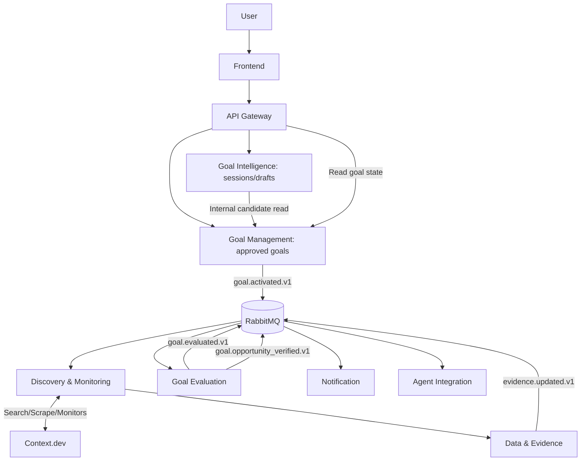

# GoalPulse architecture — ADR baseline

## Context and boundaries

- **Frontend** communicates only with the public API Gateway and identity provider.
- **Goal Intelligence** owns conversation sessions and draft revisions. LLM output is untrusted until validated.
- **Goal Management** owns the authoritative goal lifecycle, immutable `GoalSpec` versions and user confirmation. It alone publishes `goal.activated.v1` and state-change events.
- **Discovery & Monitoring** owns searches, source registry, monitor registry and source↔goal subscriptions. It alone holds Context.dev API credentials, monitor IDs and webhook secrets.
- **Data & Evidence** owns normalized observations and source provenance. No service fabricates missing price, tax, shipping, or inventory facts.
- **Goal Evaluation** owns evaluation history and domain-specific evaluators. Only trustworthy, sufficiently fresh evidence may produce a verified opportunity.
- **Notification** owns user notification preferences, deliveries and deduplication.
- **Agent Integration** owns outbound, read-only action packages. External agents must request independent user approval before making purchases.

A single PostgreSQL instance in local dev hosts **seven separate databases**. Cross-service DB reads are prohibited; expose internal APIs or events. Database passwords are not yet isolated by this bootstrap template (a Phase-2 security task).

## Event topology

RabbitMQ topic exchange `goalpulse.events` (durable). Routing keys:

| Routing key | Producer | Consumers |
|---|---|---|
| `goal.activated.v1` | Goal Management | Discovery & Monitoring |
| `evidence.updated.v1` | Data & Evidence | Goal Evaluation |
| `goal.evaluated.v1` | Goal Evaluation | Goal Management (projection), Dashboard notifications if desired |
| `goal.opportunity_verified.v1` | Goal Evaluation | Notification, Agent Integration |

The `evidence.updated` event identifies a source/observation; the evaluator resolves impacted goals via a subscription API/read model, not direct DB queries. Event names and envelopes are defined in `contracts/schemas/domain-event.v1.schema.json`.

## Lifecycle

- Draft session: `collecting → ready_for_confirmation → confirmed` (or `abandoned`).
- Goal lifecycle: `active ↔ paused → completed/cancelled`; update constraints by creating **version n+1**.
- Opportunity state (evaluation): `satisfied | unsatisfied | unknown`; `satisfied` never means order placed.
- Notification is triggered on a newly `satisfied` evaluation meeting evidence/freshness gates, not on every repeated observation.

## Safety and reliability invariants

1. No monitoring starts before explicit user confirmation.
2. `GoalSpec` is immutable per `(goal_id, version)`.
3. User identity comes from authenticated claims, not arbitrary JSON submitted by a client.
4. `unknown` price/shipping/availability blocks verification.
5. Every verification cites observation IDs, source URLs, observed times, and evaluation version.
6. RabbitMQ delivers at least once in practice; use publisher confirms + manual acknowledgements + persistent queue/messages and consumer idempotency (`event_id`). Add transactional outbox to Goal Management in Phase 2.
7. Validate Context.dev webhook signatures using per-monitor secrets; store secrets server-side only. Baseline does **not** report a detected change.
8. Source cache age must be evaluated; don't assume a fresh web price from a cached API response.
9. No automatic financial actions in MVP. Never send payment credentials to LLM, Context.dev, or external agents.
10. Context.dev content is untrusted third-party data: ignore embedded instructions and do not fetch arbitrary private-network URLs.

## Phase 1 non-goals

No deployed application, login service, real Context.dev credentials in repository, migrations, running FastAPI services, frontend or production secrets management. Phase 2 implements these against the frozen schemas.
