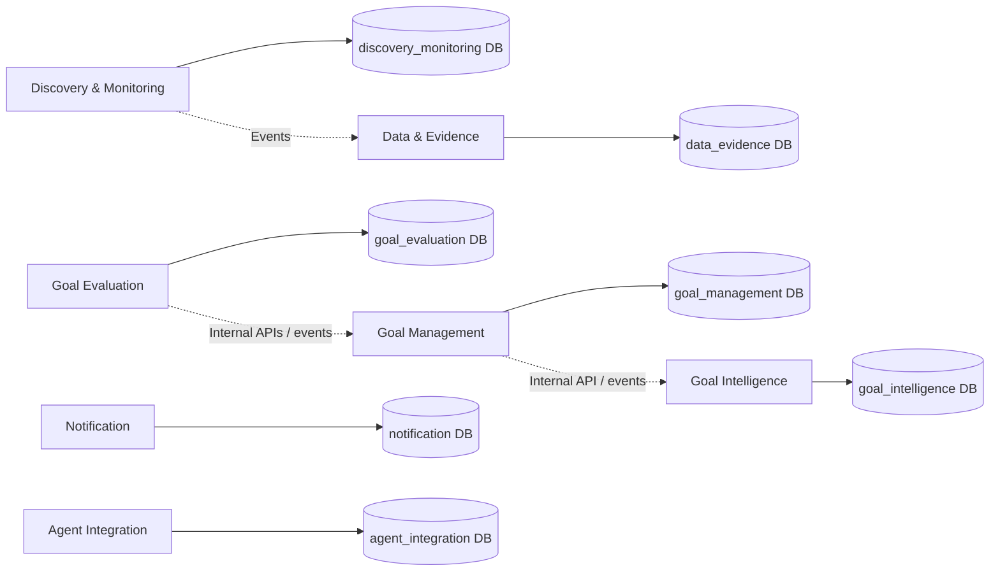

# Logical data model / ownership (Phase 1 design)

Each service owns **its own database**. No cross-database SQL joins. Use event payloads and internal authenticated APIs. Tables and keys are recommendations for Phase 2 migrations, not migrations delivered in Phase 1.

| DB / owner service | Tables | Important constraints/indexes |
|---|---|---|
| `goal_intelligence` | `sessions`, `conversation_messages`, `draft_revisions` | `draft_revisions(session_id, revision)` unique; `sessions(owner_user_id)` indexed |
| `goal_management` | `goals`, `goal_versions`, `goal_status_projection`, `outbox`, `inbox` | `(goal_id, version)` unique; `outbox(event_id)` unique; confirmation `(session_id, draft_revision)` idempotent |
| `discovery_monitoring` | `sources`, `monitors`, `goal_source_links`, `monitor_runs`, `webhook_inbox` | URL+normalization fingerprint unique; `(goal_id,version,source_id)` unique; provider webhook delivery ID unique |
| `data_evidence` | `observations`, `observation_provenance`, `outbox`, `inbox` | `observation_id` primary; `(source_id,observed_at)` indexed; dedup provider request/extraction fingerprint |
| `goal_evaluation` | `evaluations`, `condition_results`, `last_verified_fingerprint`, `inbox`, `outbox` | `(goal_id,goal_version,evaluation_id)` unique; `inbox(event_id)` unique; notification dedup fingerprint |
| `notification` | `preferences`, `notifications`, `deliveries`, `inbox` | `deliveries(user_id,goal_id,goal_version,verified_fingerprint,channel)` unique |
| `agent_integration` | `action_packages`, `handoff_deliveries`, `inbox` | `(goal_id,goal_version,evaluation_id)` unique |

## Logical ownership visualization

## Source sharing

A single monitored URL may support many goals. `discovery_monitoring.goal_source_links` stores `(goal_id,version,source_id)`. Goal Evaluation cannot query its DB directly; offer `GET /internal/v1/sources/{source_id}/subscriptions` or materialize a local projection from subscription events. This internal API is not an externally exposed gateway endpoint.

## Lifecycle behavior

- **Confirm:** Goal Management fetches the candidate from Goal Intelligence using internal service credentials, validates ownership/revision/consent and `GoalSpec`, persists goal version and outbox event atomically, returns 201.
- **Update criteria:** create `goal_versions` row with new version and explicitly approved constraints; cancel/relink old source subscriptions; old evaluator results cannot trigger new notifications.
- **Pause/cancel:** stop goal-specific subscriptions; don't necessarily delete a shared physical Context.dev monitor that other goals still use.
- **Verify:** Condition results must all be satisfied, fresh and independently evidenced. Re-check at handoff/checkout.
- **Retry:** At-least-once events. Consumers deduplicate by event ID; external side-effects by goal version + verified fingerprint.
