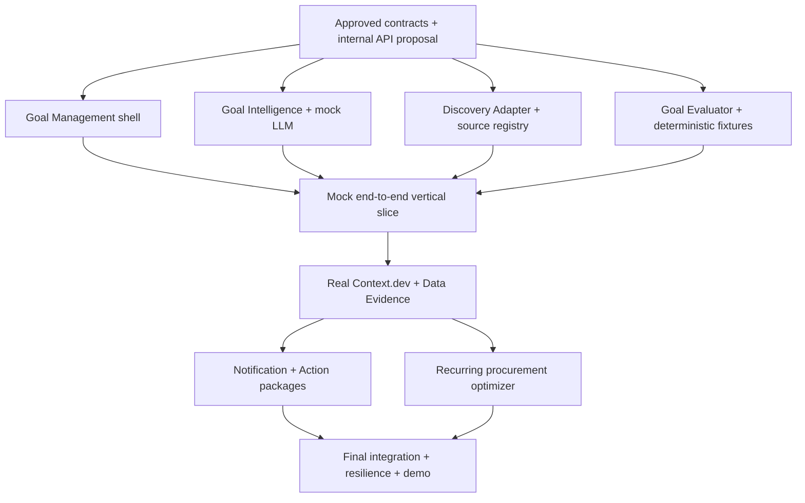

# Cross-service workflows, dependencies and state ownership

## 1. Dependency graph

Shared dependencies: External JWT auth and internal HTTP service credentials (Dev 1), RabbitMQ durable exchange/queues, stable fixtures; Dev 1 must offer mock endpoints to other owners before full persistence code exists. Do not block parallel development on a live API or real merchant data.

## 2. Conversational approval: sequence

1. Frontend POST `/v1/goal-sessions` with `initial_message`; authenticated user only.
2. Goal Intelligence creates draft revision 1; LLM proposes typed fields; deterministic completeness/consistency checker computes `missing_fields`, `next_question`, `ready_for_confirmation`.
3. Client sends `expected_revision` on each follow-up; Intelligence compares it transactionally and returns 409 on stale write; draft revisions are monotonic.
4. When candidate is valid, frontend shows summary derived from canonical typed fields, not merely natural-language LLM text; user explicitly clicks Confirm on that exact revision.
5. Gateway POST `/v1/goal-sessions/{session_id}/confirm` to Goal Management; GM uses authenticated internal GI candidate read (expected revision + owner) and checks `ready_for_confirmation=true`.
6. GM constructs strict GoalSpec (server-generated IDs, EUR cents, user from JWT, approval timestamp), persists immutable `(goal_id, version=1)` and outbox `goal.activated.v1` in **one** DB transaction. Unique `session_id` prevents duplicate goals.
7. GM responds with valid GoalSpec. Outbox publisher eventually emits event. GI `mark-confirmed` is best-effort and idempotent; if it fails, GM remains source of truth. User can re-request same confirmation without duplicate activation.
8. DM consumes event, fetches exact approved GoalSpec, discovers sources and **performs initial scrape**. Creating a Context.dev monitor alone is not enough to populate initial results.

## 3. Web-change, evidence, evaluation, user action: sequence

1. DM creates source/goal-version subscriptions; shared provider monitor keyed by canonical source URL and policy fingerprint. Dedup provider webhook and securely validate signature.
2. DM makes initial scrape or subsequent monitored fetch via Context.dev. Results are untrusted; inspect successful extraction format, capture request ID/provider snapshot age.
3. DM submits extraction to DE through authenticated internal HTTP (not RabbitMQ); DE validates provider/canonical URL, maps to strict Observation, stores observation+source reference+outbox atomically. Failed/partial extraction stored as attempt/error, **not** fabricated Observation.
4. DE publishes `evidence.updated.v1` with `source_id`+`observation_id` (existing payload exactly).
5. GE consumes and resolves affected goal-version subscriptions from DM internal API, calls GM to check currently active version, fetches observations from DE, evaluates. It must never query other services' PostgreSQL DBs.
6. GE persists `GoalEvaluation` + outbox `goal.evaluated.v1`; when all required conditions are checked+fresh and no unknowns, emits `goal.opportunity_verified.v1` with the existing minimal payload.
7. GM consumes `goal.evaluated.v1` and updates its dashboard read model only if version matches latest approved version. GE owns evaluation detail; GM only projection.
8. NS and AI (Agent Integration) receive verification event; fetch canonical evaluation from GE, goal lifecycle/owner/version from GM, evidence from DE. Verify active latest version again before delivery. NS stores dedup key, then delivers in-app notification; Agent Integration creates read-only package.

## 4. State and temporal semantics

- GI `collecting → ready_for_confirmation → confirmed | abandoned`. No monitoring in GI.
- GM `active ↔ paused`, terminal `completed | cancelled`. `GoalSpec` immutable; lifecycle stored independently of versioned spec.
- GE result `satisfied | unsatisfied | unknown`. Notification is a *verified opportunity*, not goal completion.
- DM subscription state per `(goal_id, goal_version, source_id)`: active, inactive, error. Shared monitors live while >=1 active subscriber; on pause/cancel only deactivate that link.
- **Important gap:** Existing `domain-event.v1` has no `goal.paused`, `goal.resumed`, `goal.versioned`, `goal.cancelled` keys. Do not invent them. For the MVP, DM performs polling reconciliation of active goals through authenticated GM internal reads and manages subscriptions; Dev 1/3 agree on poll interval and test pause suppression. Follow-up ADR can add versioned lifecycle events for low latency.
- **Important gap:** There is no public goal-criteria editing operation in frozen `gateway.v1.yaml`. MVP supports initial confirmation and lifecycle; editing criteria requires a separate approved API and versioning release.
- Obsolete event/observation or GC of source links cannot verify a paused/obsolete version. Capture immutable evaluation provenance even if source later disappears.
- Dedup evaluations by `event_id` for processing, and user-visible notifications by stable opportunity fingerprint (goal/version + normalized product/seller + threshold crossing; not `event_id` alone). New lower price may merit a new notification after review-approved policy; do not spam repeats.

## 5. Failure / recovery table

| Failure | Expected recovery |
|---|---|
| LLM malformed JSON / unsupported request | Retry bounded for model formatting, otherwise ask clarification / mark unsupported; never activate invalid goal |
| Stale user revision | 409; fetch current draft and render new summary |
| Goal persisted but RabbitMQ down | Outbox keeps intent; publisher retries; one activated goal only |
| Web scrape HTTP 200 but `success=false` | Persist extraction failure with provider error; no fake price |
| Context webhook redelivery | Signature check then unique provider delivery ID / inbox dedup; fast 2xx after durable enqueue |
| Source page cached/stale | Use provider cache metadata, return unknown if beyond goal max evidence age |
| Observation has missing shipping/tax | Preserve null, evaluation unknown; never zero-fill |
| `evidence.updated` redelivered | Consumer inbox event dedup; zero duplicate side effects |
| Goal paused between GE verification and NS dispatch | Notification rechecks active/latest version and suppresses |
| NS channel failure | Retry bounded; persist attempts; later DLQ; no duplicate delivery |
| External agent retries handoff | Stable immutable package ID; never executes order |

## 6. Dependency release gates

- **Gate A:** frozen schemas pass, internal API proposal signed off, fixture protocol agreed.
- **Gate B:** GM+GI+GE+DM mocks can complete browser flow in a dockerized stack, without external web.
- **Gate C:** initial real Context.dev scrape→DE→GE with source evidence, using a known accessible page.
- **Gate D:** signed monitor webhook redelivery test, stale/missing/duplicate testing, one notification, one prepare-only action package.
- **Gate E:** second domain (recurring procurement), observability and demo rehearsals. Skip Gate E extras rather than compromising Gates A–D.
