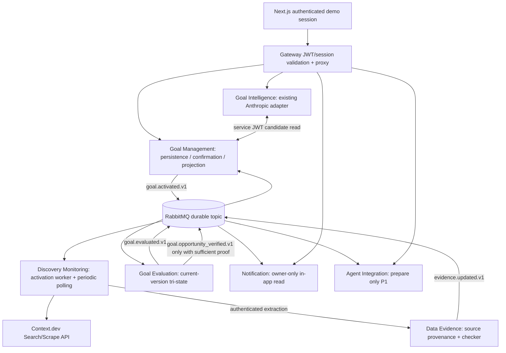

# Phase 2 Architecture — runnable, truthful MVP

**Input facts from audited commit `5186edf`:** Gateway currently only `/health/live`; Compose only Postgres/Rabbit; GI Anthropic real adapter exists but fixture selected by default; DM ContextProvider real adapter exists but probe-only; DE checked unreachable; GE/NS/AI cores lack running adapters; FE mock-default. All seven service domain cores have substantial code. **Do not rewrite those cores.**

## Runtime / data ownership

| Service or component | Owner | Runtime | Integration requirement |
|---|---|---|---|
| Gateway | D1 | FastAPI HTTP, private service proxy | Seven frozen public endpoints, owner JWT, accepted ICP-08 M2M claims, demo-only session extension |
| Goal Management | D1 | FastAPI + outbox publisher + evaluation consumer | GI candidate reader, owned Postgres; true projection from GE |
| Goal Intelligence | D2 | FastAPI | Existing Anthropic adapter via env, persistent chat revisions, strict draft validation |
| Discovery & Monitoring | D3 | internal FastAPI + activation consumer + periodic worker | Real ContextProvider in main path, GM authenticated reader, DE submission, rate-budget |
| Data & Evidence | D3 | internal FastAPI + publisher | Owned immutable ledger, first-party provenance checker, `checked` only via internal method |
| Goal Evaluation | D4 | Rabbit consumer + internal HTTP | GM/DM/DE readers via service JWT, owned Postgres inbox/outbox |
| Notification | D4 | Rabbit consumer + owner read API | Deterministic dedup and owner-only fetch, owned DB |
| Agent Integration | D4 | Rabbit consumer + owner read API **P1** | canonical grouped seller_orders, prepare_only, expires, needs user approval |
| Frontend | D2 | Next.js Node 22 | real Gateway client, authenticated cookie-based session; no direct provider keys |

## Precise main-path sequences

**Activation:** browser POST session/message through GW → GI produces validated revision → frontend displays canonical summary/revision → owner clicks confirm → GW proxies GM → GM re-reads exact GI candidate revision with service JWT and validates → transactional version + goal.activated.v1 outbox → publisher confirms RabbitMQ → DM worker ACK after durable activation job recorded.

**Initial scan:** DM authenticates to GM to load active GoalSpec → discover first-party seller URLs via Context.dev Search → public-URL safety checks → fresh Context.dev Scrape (provider-specific SDK/API call existing adapter) → preserve request/observed/cache timestamps and source identity → send normalized extraction to DE internal API (never set checked directly) → DE stores immutable Observation or durable failure, checker promotes only if ADR conditions hold → DE outbox publishes evidence.updated.v1.

**Evaluation:** GE consumes evidence.updated.v1 → resolve source subscriptions with DM and current goal version from GM → fetch newest DE observation(s) → evaluate three-valued hard conditions, evidence freshness and checker trust → commit result/outbox → publish goal.evaluated.v1 to GM projection; `goal.opportunity_verified.v1` ONLY if all mandatory conditions checked and satisfied → NS/AI consume if enabled.

**Polling:** DM scheduler periodically finds due active subscriptions from its own DB, rechecks current goal state via authenticated GM read before spending Context credits, respects quotas and dedups jobs. Operator CLI `check-now` uses same job scheduling code, is not public user endpoint. If paused/changed: abort old version; no positive alert.

**UI:** show status for every hard condition, observed_at, source(s), reliability labels, freshness/caveats, last attempted check and failures. A real unknown does not change to verified simply because an event arrived. Notifications are in-app; agent package is optional P1.

## Internal vs public APIs

- Browser calls **Gateway only**. Gateway implements frozen seven v1 public paths with correct status/auth and forwards to service APIs using accepted identity (no direct browser service port).
- Service-to-service clients use accepted ICP-01 internal endpoints + ICP-08 JWT. No direct cross-service SQL. Proposed reads require additive approved public contract; no spontaneous routes or field names.
- For the demo-only login create **versioned separate extension** (`/v2/demo/sessions`), explicitly disabled outside isolated demo profile. Do not copy dev JWT tokens into browser storage.
- Frontend notification/action reads require new *additive* versioned public contract before use.

## Correct failure propagation

- LLM failure => visible retry / input preserved / no activation; never mock fallback.
- Context timeout, blocked page, missing page data => durable failure/unknown, not `price=0` or `in_stock` fabricated.
- DE cannot confirm/check => unverified/candidate, no verified alert. GE never bypasses its checked gate.
- Rabbit redelivery => inbox/outbox idempotent, no duplicate Notification; DLQ and operator replay documented.
- Service/broker/DB outage => /ready false or clear unavailable; browser honest error and retry.

## Not yet production-safe

Demo-only auth is not OIDC/production user security; official booking/shop cart/checkout inventory not available. No full GDPR/operational SLA certification. Do not deploy publicly or charge customers using only these controls.
