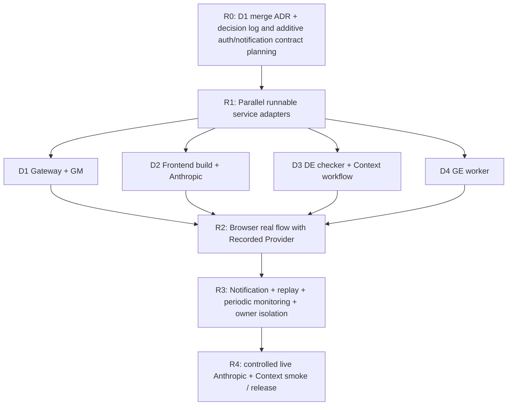

# Parallel execution and integration gates (no approval meeting required)

**Never make a service owner wait for another service's complete production code when accepted contracts/recorded fixtures suffice.** D1 owns the only coordinated shared-contract PR. One ticket per coding agent branch.

| Gate | Required merged outcome | Parallel ownership | Hard stop |
|---|---|---|---|
| **R0** | ADR-0003, current decision log updated; frozen v1 unchanged; agreed demo auth, HTTP extension stub, DE policy; Node22/Python3.12 verified | D1 docs/contracts; D2 fix build; D3 checker tests; D4 GE worker on recorded fixtures | Any owner has unapproved new public field/route, trust bypass or direct cross-service DB read |
| **R1** | Gateway and P0 service containers/commands start (AI package worker optional P1); GI/GM/DM/DE/GE respond/consume; DB migrations run in disposable env; workers ready | D1 Gateway/GM; D2 GI/frontend; D3 DM/DE; D4 GE | Real mode invokes fixture silently; any core service lacks readiness/connection |
| **R2** | One user goal: Browser → Anthropic or recorded GI model response (separately labeled) → confirmed GM → Rabbit → recorded Context response via **actual DM worker** → DE → GE → persistent dashboard | Same service owners; D1 E2E runner | UI still synthetic, no source URL / timestamp, or success generated without proof |
| **R3** | Notification worker and owner reads; periodic scanning; duplicate/stale/paused/outage tests; two-owner isolation; optional AI package | D4 NS, D3 scheduler, D2 UI, D1 integration | Unverified emits Verified; duplicate notification; stale goal version active |
| **R4** | **Controlled real API calls**: one Anthropic non-sensitive dynamic clarification, one Context.dev activation-path source capture; actual UI evidence; final evidence of tests | D2 → D3 → D4 → D1 signoff | Live test fails, must display limitation honestly, never switch to fake |

## Operational target / simplification

- R0 is a **single D1 change PR**, not a four-person meeting. Members can asynchronously signal only concrete blockers in their owned area. D1 checks compatibility and merges after normal repo protections.
- R1 work starts in parallel immediately against ADR-0003. If D1 Gateway not ready, D2 tests Anthropic standalone, D3 tests Context adapter/DE trust with recorded payload, D4 builds GE with recorded clients.
- P0 stops after real single product can be evaluated and honest unknown/candidate state displayed, periodic monitoring works and in-app notification path passes deterministic verification. Agent package P1; café optimizer P1; native Context monitors P1.
- No public production release or payment functionality is authorized.

## Developer work coordination

1. Each developer uses separate worktree/branch; allowed service paths only.
2. At beginning of a task read `AGENTS.md`, this ADR, task file, **current** contracts & current git status.
3. Announce only interface changes; avoid file ownership conflicts.
4. Publish recorded input/output fixtures for all upstream/downstream APIs, with no secrets.
5. Finish task with test result and explicit handoff (ports, environment key names, event contracts and commands).
6. D1 integrates early and reruns full-stack tests after every merge.
