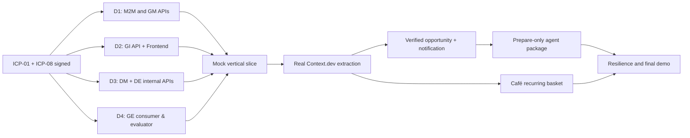

# GoalPulse — Master implementation backlog and dependency gates

**Status:** planned tasks, not completed code. For exact implementation, consult `docs/implementation/0X-*.md` and `tasks/developer-N.md`. A task is done only after tests and team PR review; assigning to a coding agent is not a completion. All four developers follow `AGENTS.md`.

## Priority and gate interpretation

- **P0:** demo's correct end-to-end behavior and safety. Must complete or clearly explain honest limitation.
- **P1:** richer product proof (second goal type, real monitor, agent package and notifications UI).
- **P2:** optional production polish; skip before P0.
- **Gate A:** sign off contracts/identity, scaffold environment; parallel with UI mock and Context.dev feasibility.
- **Gate B:** four developers build independently using agreed fixtures; integrate early via dummy adapters.
- **Gate C:** end-to-end mock slice then Context.dev live extraction+DE.
- **Gate D:** monitoring, notification, agent package and resilience.
- **Gate E:** second goal category, UI polish, final frozen demo.

## Task dependency chains

## Owner-ready checklist

| Owner | Tasks | Critical Gate B deliverable | Integration handoff |
|---|---|---|---|
| Dev 1 | D1-PL-01..03, D1-GM-01..05, D1-GW-01, D1-INT-01..02, D1-DOC-01 | Approved internal APIs, authenticated GM confirm/get, RabbitMQ outbox, gateway | Mock GM runtime/versions, signed principal, Rabbit bindings |
| Dev 2 | D2-GI-01..05, D2-FE-01..04 | Incomplete text → clarifications → strict ready Draft → confirmation UI | Draft fixtures/revision conflicts, typed UI client |
| Dev 3 | D3-DM-01..06, D3-DE-01..05 | Activated source→initial extraction→strict Observation and event | Mock subscriptions/observations, live redacted provider report |
| Dev 4 | D4-GE-01..06, D4-NS-01..03, D4-AI-01..03 | Evidence event→tri-state decision→verified event and safe notification | Evaluation fixtures, user notification and package DTO |

## Exact first eight actions (team execution order)

1. **D1 with all:** approve ICP-01 and ICP-08; record decision; freeze additions before changes.
2. **D1 parallel:** D1-PL-02/03 infra+security scaffold, D1-GM-01 DB.
3. **D2 parallel:** D2-GI-01/02 and D2-FE-01 shell with mocked token/session.
4. **D3 parallel:** D3-DM-01 Context.dev product probe and D3-DE-01 storage skeleton.
5. **D4 parallel:** D4-GE-01 + D4-GE-03 pure ProductPurchaseEvaluator against frozen fixtures.
6. **D1+D2:** integrate GI candidate read → GM confirm; D1 sends GoalActivated fixture.
7. **D3+D4:** integrate DM subscriptions → DE evidence.updated → GE evaluated & verification; D4 NS mock.
8. **All:** run D1-INT-01 mock E2E **before** hardening and second goal category.

## Early integration milestone

`POST /v1/goal-sessions` → two clarifying turns → `POST .../confirm` → GM durable outbox → DM fixture source → DE strict Observation → GE strict Evaluation → NS one in-app result. All contracts validated, RabbitMQ messages durable, no browser direct private HTTP, no manual DB patch. Live provider is swapped in **after** this succeeds.

## Acceptance gates and owner of release

| Gate | Observable outcome | Owner(s) |
|---|---|---|
| A | internal API + auth signed, existing schemas pass | D1 with all |
| B | first mock E2E, product valid/invalid/unknown cases | D1 integration, D2/3/4 service owners |
| C | real Context.dev initial scrape, timestamp/provenance, no fake unknowns | D3 + D4 |
| D | monitor webhook replay, pause suppression, one notification, safe handoff | D1+D3+D4 |
| E | café basket full/sparse tests, dashboard and demo rehearsal | D2+D4, whole team |

## Stop / go rules

- If a schema/field mismatch appears: stop cross-service implementation of that interface and raise ICP; do not quietly amend v1.
- If live merchant page cannot expose real cost/stock, mark unknown and choose a demonstrably extractable public product source; **do not** fake live availability.
- If mock E2E fails, freeze P1 features until Gate B works.
- If only one evaluator can be completed, favor reliable product purchase over superficial support for all goals.
- If Docker unavailable, mark infra tests NOT RUN; contract-only tests are not operational proof.

## Links

- [All service specs](../docs/implementation/README.md)
- [Dependency and state workflows](../docs/implementation/09-dependencies-workflows.md)
- [Proposed internal contracts](../docs/implementation/10-internal-contracts.md)
- [Mandatory test matrix](../docs/implementation/11-testing-and-acceptance.md)
- [Pending decisions](../docs/implementation/12-contract-gaps-and-decisions.md)
